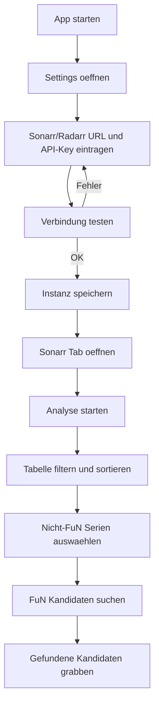
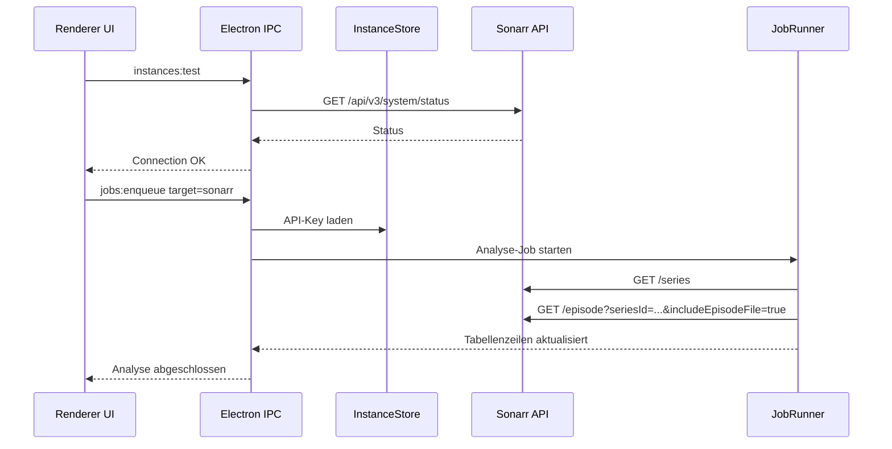
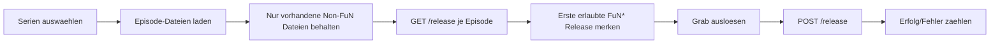

# ARR Ops

ARR Ops ist eine lokale Electron-App fuer haeufige Sonarr- und Radarr-Aufgaben. Der erste Fokus ist FuN*-Coverage: Serien analysieren, den Anteil von FuN-Releasegruppen sehen, passende FuN*-Kandidaten suchen und gefundene Kandidaten kontrolliert grabben.

API-Keys werden in der App gespeichert und ueber Electron `safeStorage` verschluesselt. Die lokale `.env` ist nur fuer Entwickler- und Live-Tests gedacht und wird nicht versioniert.

## Funktionen

- Sonarr und Radarr getrennt oder gemeinsam konfigurierbar.
- Verbindungstest fuer Sonarr/Radarr ueber die Electron-IPC-Bridge.
- Sonarr-Analyse ueber alle Serien mit Episodenanzahl, Dateianzahl, Gesamtgroesse und FuN*-Anteil.
- Sortierbare und filterbare Sonarr-Tabelle mit sticky KPI-/Menueleiste und sticky Tabellenkopf.
- Suche nach FuN*-Kandidaten fuer ausgewaehlte Sonarr-Serien.
- Grab von zuvor gefundenen FuN*-Kandidaten fuer ausgewaehlte Sonarr-Serien.
- Tray-Icon und Windows-Notifications fuer Hintergrundbetrieb und Job-Ergebnisse.
- Grundlagen fuer Quoten, Zeitplaene, lokale Historie und Radarr-Erweiterungen sind vorbereitet.

## User Flow



## Interner Ablauf



## Search/Grab Flow



## Entwickler-Setup

```powershell
npm install
Copy-Item .env.example .env
```

`.env` fuer Live-Tests:

```dotenv
SONARR_URL=http://192.168.0.170:8989
SONARR_API_KEY=replace-me
RADARR_URL=http://192.168.0.170:7878
RADARR_API_KEY=replace-me
```

## Kommandos

```powershell
npm run dev          # Electron-App im Entwicklungsmodus
npm run lint         # TypeScript-Pruefung
npm test             # Unit-Tests, inkl. better-sqlite3 Rebuild fuer Node
npm run test:live    # Live-API-Tests gegen .env, ohne Grabs
npm run test:e2e     # Playwright-Tests; Electron-Live-Tests skippen ohne EXE
npm run build        # TypeScript + electron-vite Build
npm run dist:win     # Portable Windows EXE bauen
```

## Windows-EXE erstellen

Die App wird als portable Windows-EXE mit `electron-builder` gebaut. Voraussetzung ist ein installiertes Node.js/npm-Setup und installierte Dependencies:

```powershell
npm install
```

Vor einem Release-Build lokal pruefen:

```powershell
npm run lint
npm test
```

Neue portable EXE bauen:

```powershell
npm run dist:win
```

Der Standard-Build schreibt nach `release` und erzeugt:

```text
release\ARR Ops 0.1.0.exe
```

Wenn Windows eine alte Ausgabe sperrt, z. B. weil die App noch laeuft oder ein Explorer-Fenster Dateien haelt, App schliessen und den Build erneut starten. Alternativ kann ein anderer Output-Ordner genutzt werden:

```powershell
npm run build
npx electron-builder --win portable --x64 --config.directories.output=release-fixed
```

Die EXE liegt dann z. B. unter:

```text
release-fixed\ARR Ops 0.1.0.exe
```

Gepackte Electron-App gegen IPC und Live-Sonarr testen:

```powershell
$env:ARR_OPS_ELECTRON_EXE='C:\Users\asi\Documents\GitHub\arr-mgmt\release-fixed\win-unpacked\ARR Ops.exe'
npx playwright test electron-ipc.spec.ts
Remove-Item Env:ARR_OPS_ELECTRON_EXE
```

Alternative Build-Ausgabe, falls ein alter `release`-Ordner gesperrt ist:

```powershell
npm run build
npx electron-builder --win portable --x64 --config.directories.output=release-fixed
```

Die portable EXE liegt danach z. B. unter:

```text
release-fixed\ARR Ops 0.1.0.exe
```
